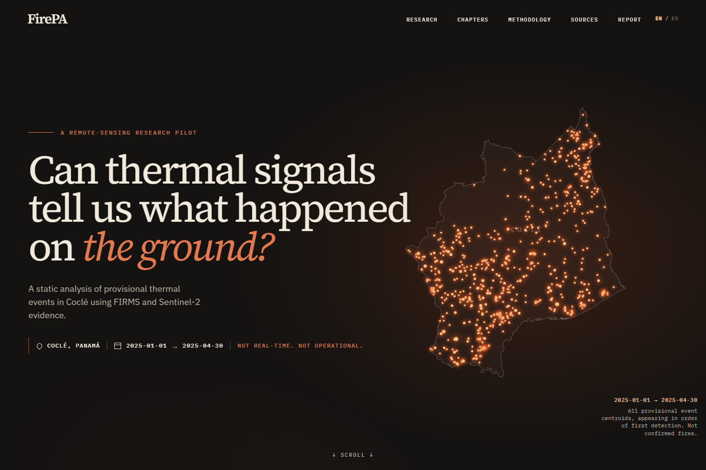
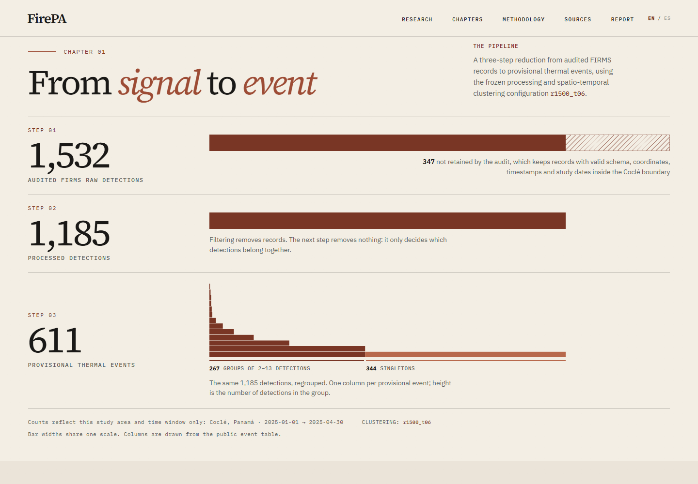
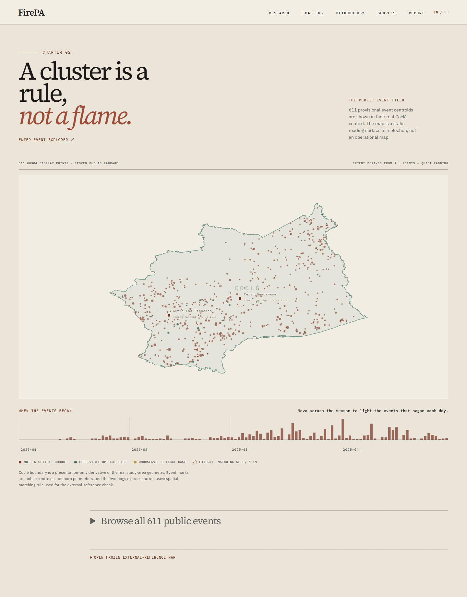
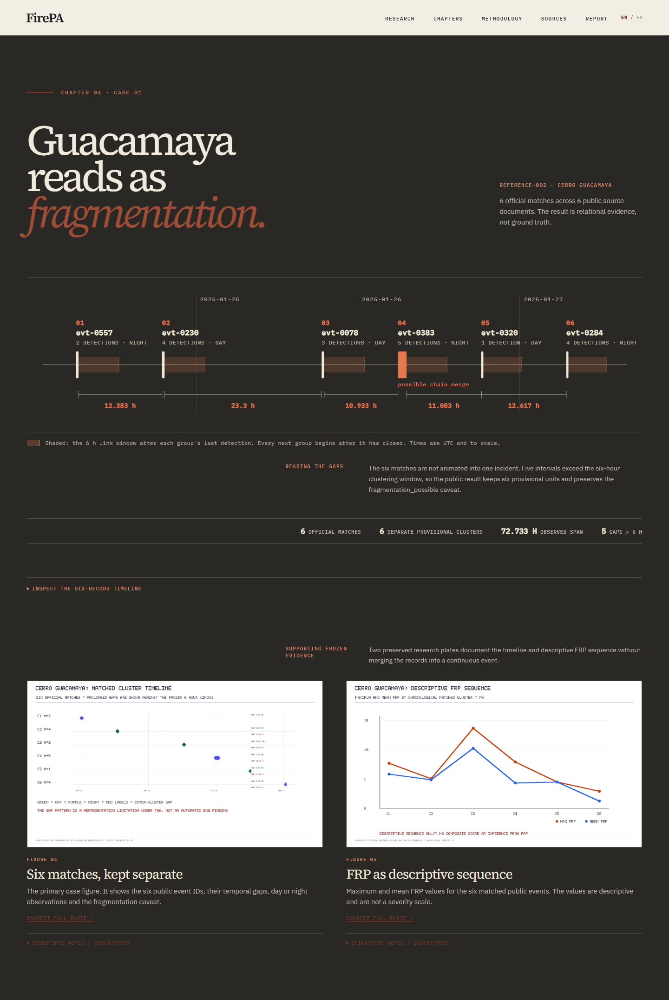
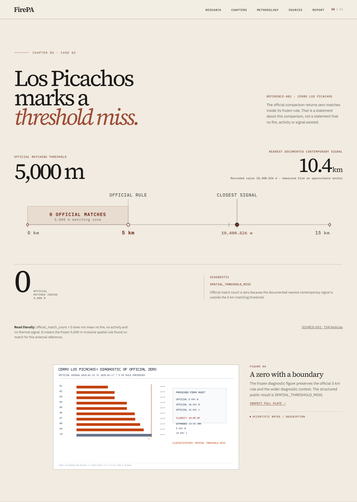

# FirePA

FirePA started with a simple question: if a satellite detects a thermal
anomaly, how much can I responsibly say about what actually happened on the
ground?

I built FirePA to explore that question using NASA FIRMS detections over Coclé,
Panama, from January through April 2025. The pipeline audits 1,532 raw
detections, retains 1,185 inside the study area, and groups them into 611
provisional thermal events using a frozen spatiotemporal rule.

The important distinction is that those 611 events are not "611 fires."
FirePA uses Sentinel-2 follow-up, public incident references, explicit
thresholds, frozen artifacts, and reproducibility checks to show what the
evidence supports, where it becomes ambiguous, and where the analysis has to
stop.

[Live website](https://firepa.pages.dev/) ·
[Scientific report](https://firepa.pages.dev/report.pdf) ·
[Methodology](docs/METHODOLOGY.md) ·
[Public validation](https://github.com/jrod-md/FirePA/actions/workflows/public-validation.yml)

[](https://github.com/jrod-md/FirePA/actions/workflows/public-validation.yml)

## GitHub listing

- **Website:** [firepa.pages.dev](https://firepa.pages.dev/)
- **Description:** Reproducible remote-sensing research pilot for provisional thermal events in Coclé, Panama.
- **Topics:** `remote-sensing`, `earth-observation`, `geospatial`, `satellite-data`, `python`, `astro`, `cloudflare-pages`, `github-actions`

## Results at a glance

| Item | Frozen result |
|---|---:|
| Audited FIRMS raw detections | 1,532 |
| Processed detections in Coclé | 1,185 |
| Clustering configuration | `r1500_t06` |
| Provisional thermal events | 611 |
| Singleton events | 344 |
| Multi-detection events | 267 |
| `possible_chain_merge` events | 17 |
| Sentinel-2 optical cohort | 30 |
| Observable / unobserved | 28 / 2 |
| Formal human observations | 0 |
| External source documents / incidents | 7 / 2 |

The scientific freeze commit is
`7694da7df5808911de48de84016759c5fd22f176`.

## What I built

I organized the project as a sequence of bounded analytical steps:

1. Audit 1,532 historical NASA FIRMS VIIRS detections.
2. Retain 1,185 valid records inside Coclé and the inclusive study window.
3. Group detections under `r1500_t06`, using connected components with a
   1,500 m spatial link, a six-hour temporal link, and metric distances in
   `EPSG:32617`.
4. Preserve the resulting 611 groups as provisional thermal events, including
   344 singleton events, 267 multi-detection events, and 17 records flagged
   `possible_chain_merge`.
5. Follow a frozen 30-event cohort with Sentinel-2. Twenty-eight cases are
   observable under the documented policy and two remain `unobserved`.
6. Use NBR and dNBR only as descriptive optical evidence, never as fire labels
   or validated severity classes.
7. Compare the event field with two approximate public incident anchors using
   temporal overlap and an inclusive 5,000 m distance rule.

The results are published as a bilingual static site and a deterministic
`site-data/` package. The package includes 611 public WGS84 centroids,
methodology and provenance records, the external-reference chronology, and six
byte-frozen scientific figures.

## Screenshots

These captures show real, frozen historical research data from the public
release for Coclé, Panama (January–April 2025), rendered by the locally running
English publication.

### Home – Hero: the research question and study frame

The opening introduces the question behind FirePA, the study area and dates,
and the boundary between historical analysis and operational monitoring.



### Evidence chain: from 1,532 detections to 611 provisional events

The three-step ledger distinguishes filtering from grouping: 1,532 audited
records become 1,185 processed detections, then 611 provisional thermal events.



### Event field map: centroids, reference anchors, and the 5 km rule

The map places all 611 public centroids in Coclé, alongside two approximate
incident anchors and their matching-rule rings. The seasonal strip shows when
events began; the points and rings do not represent burn perimeters.



### Guacamaya fragmentation: six matches remain six separate groups

The time axis makes the five gaps above six hours visible. The case preserves
six provisional clusters across a 72.733-hour span, with the frozen timeline
and descriptive FRP figures below.



### Picachos threshold: why the official comparison returns zero matches

The distance scale compares the inclusive 5,000 m rule with the nearest
documented contemporary signal at 10,400.826 m. The view keeps the threshold
diagnostic explicit: zero matches does not establish that no fire occurred.



## Two cases that shaped the analysis

### Cerro Guacamaya

The official comparison returns six separate provisional clusters. Five gaps
between them exceed six hours, while the complete sequence spans 72.733 hours.
The frozen interpretation is `fragmentation_possible = true`: a prolonged
documented incident can correspond to several analytical units under the
six-hour grouping convention. That result is a representation limitation, not
permission to merge the clusters into one event.

### Cerro Los Picachos

The official inclusive 5,000 m comparison returns zero matches. The nearest
documented contemporary signal is 10,400.826 m from the approximate anchor, so
the frozen diagnostic is `SPATIAL_THRESHOLD_MISS`. The zero is a threshold
result. It is not evidence that no fire, activity, or thermal signal existed.

## What FirePA does not claim

FirePA does not provide:

- a count of confirmed fires;
- ground truth or institutional validation;
- a validated severity classification;
- a supervised predictive model;
- operational monitoring or alerts; or
- real-time analysis.

Formal human observations remain zero. External references provide relational
context, not truth labels, and the two `unobserved` optical cases are unresolved
rather than negative cases.

## Explore the project

- [Live bilingual publication](https://firepa.pages.dev/)
- [Scientific report](https://firepa.pages.dev/report.pdf)
- [Methodology](docs/METHODOLOGY.md)
- [Sources and provenance](SOURCES.md)
- [Data and reproducibility](docs/DATA_AND_REPRODUCIBILITY.md)
- [Scientific limitations](docs/LIMITATIONS.md)

## Reproduce the public release

Python 3.10 or later is required. From a clean clone:

```powershell
python -m venv .venv
.\.venv\Scripts\Activate.ps1
python -m pip install ".[dev]"
python scripts/verify_public_release_package.py --package site-data
python -m pytest -q
```

Build and verify the static publication with Node.js and npm:

```powershell
cd site
npm ci
npm run build
npm run test
```

The Astro project lives in `site/`, so `npm run dev` must also be run from that
directory. The build works without the non-redistributed source boundary by
using the tracked deterministic Coclé presentation derivative.

A clean clone verifies the complete public package, but it cannot regenerate
the entire scientific history. Raw FIRMS inputs, private review mappings,
Sentinel-2 rasters, Earth Engine outputs, and original reference geometry are
deliberately excluded. When those protected inputs are available locally, the
stricter gate can verify their frozen hashes:

```powershell
python scripts/verify_public_release_package.py --package site-data --full-source
```

That command is expected to fail in a normal public clone because the protected
inputs are absent. The public verifier and site build do not fabricate
substitutes.

## Repository structure

```text
docs/          Scientific report, methodology, limitations, and technical records
references/    Frozen external-source registry
report/        Reproducible academic PDF generator and verification tools
scripts/       Scientific pipeline and public-package verification entry points
site/          Bilingual Astro static publication
site-data/     Public machine-readable package and frozen figures
src/fuegopa/   Python implementation
tests/         Scientific and publication-contract tests
```

Downloaded inputs and generated research outputs are intentionally excluded
from Git. Tracked `.gitkeep` files document the corresponding local directories.

## Data and sources

I document each public source and its role in [SOURCES.md](SOURCES.md).
Redistribution boundaries and third-party asset terms are recorded in
[NOTICE.md](NOTICE.md) and
[docs/ASSET_PROVENANCE.md](docs/ASSET_PROVENANCE.md). The public package also
contains its own manifest, provenance ledger, and citation registry.

## Citation

If you use or reference FirePA, citation metadata for Jose Rodriguez and
version 1.0.0 is available in [CITATION.cff](CITATION.cff). No DOI or publication
venue is claimed.

## CI/CD and deployment

The **Public validation** workflow runs on pull requests to **main** and pushes to **main**. It verifies the public Python package and runs its tests, then builds and checks the Astro publication. Deployment is handled by Cloudflare Pages Git integration on **main** instead of a Wrangler deploy step in Actions.

With Git integration enabled, no Cloudflare API token secrets are needed in GitHub Actions for deployment. Keep branch protection on **main** so merges require the validation checks before Cloudflare publishes a new production build.

The workflow verifies the checked-in public package and publication source. It does not regenerate or edit frozen scientific inputs, results, figures, or the **site-data/** package.
## License

FirePA-authored source code is available under the [MIT License](LICENSE).
Third-party data and source materials retain their own terms as documented in
the provenance records above.
